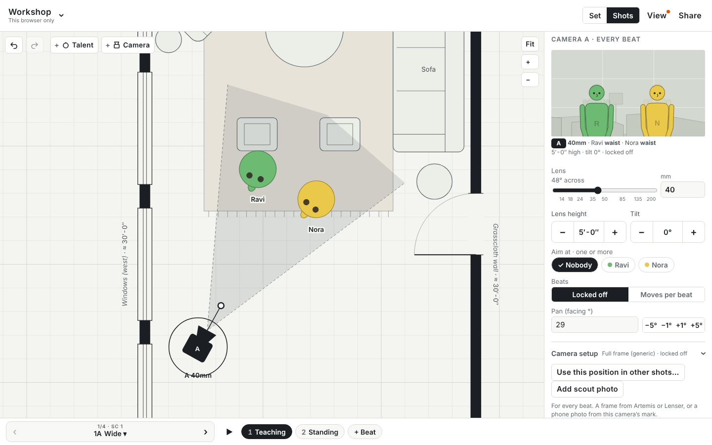
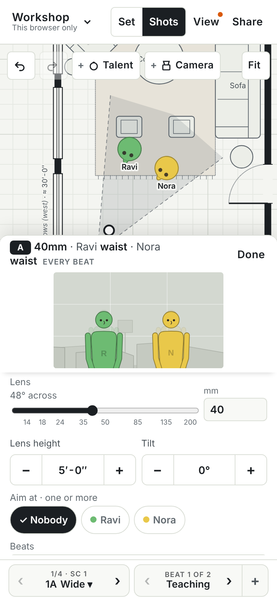

<p align="center"></p>

# Overheads

Plan camera coverage from overhead and see what each camera frames while you block. Draw the room, put your talent and cameras in it, step through the beats of each shot, and every camera's frame updates as you move things: lens, height, tilt, who's in frame and how they're cut, and how far each person is from the plane of focus.

It's one HTML file. There's no build step, no server and no account. It runs in a browser on a phone, tablet or laptop and saves to that browser.





## Use it

Open `index.html` in a browser, or the copy published with GitHub Pages. Plans stay in the browser you made them in. To move a plan to another device, use **Share → Plan file**, then **Import plan file…** in the production menu.

## What it does

- **Productions, scenes, shots and beats.** Scenes run in story order. Each scene picks a location, and each shot has beats for the moves inside it. Shot codes follow the slate: 25A, 25B and so on, skipping I and O.
- **Locations.** Walls, doors and windows belong to a location and are shared by the scenes set there; a scene can keep its own copy when the room changes in the story. Furniture, lights and diffusion belong to each scene. You can bring them in from any other scene, which is how you reuse a day look or a night look.
- **Cameras.** Real sensor sizes for common bodies, recording modes, anamorphic desqueeze and aspect ratios. Aim at one or more people, place them in frame, and match focus distances. A camera is either locked off or moves per beat.
- **Talent.** Pictogram figures that stand, walk or sit, face a camera or another person, and move along curved paths between beats.
- **Lighting.** Lights and diffusion frames are drawn on the plan, and their effect shows in the frames.
- **Output.** A PDF for crew, with an overview of every setup at each location, a page per beat and a shot list grouped by scene. You can also export a text shot list, or copy and download the shot list as a spreadsheet. A spreadsheet shot list (Scene, Shot, Int/Ext, Time, Location, Shot Type, Shot Description, Special Tools, Synopsis, Notes) can be imported as well.

## Using it with an AI

Any chat AI can edit a plan. **Share → Copy for AI** copies the current plan as JSON, with a short set of instructions that explain the format. Paste that into ChatGPT, Claude or another assistant and ask for what you want, for example "add a two-shot from the window side" or "block scene 4 like scene 2, but at night". Then copy its whole reply and use **Share → Paste overhead…**. Overheads finds the plan in the reply and shows what changed. You can replace the current production with it, or add it as a new one. Undo takes a replacement back.

The full plan format is documented in [docs/FORMAT.md](docs/FORMAT.md), for scripts and for anyone who wants an AI model to write plans from scratch.

## Privacy

Nothing is sent anywhere. Plans, and a tally of which controls get used, are kept in your browser's storage. The page loads jsPDF from cdnjs for PDF export, and the Inter typeface from Google Fonts.

## Development

All the code is in `index.html`. The regression suite drives that file in headless Chrome with Playwright:

```
cd tests
npm install                      # jsPDF, served to the page under test
pip install -r requirements.txt  # pytest, playwright
python -m pytest -q              # about 9 minutes
```

Chrome is expected at `/usr/bin/google-chrome`; set `OVERHEADS_CHROME` to use another browser binary. The suite also runs the page with a stub of the claude.ai host runtime, which is where the app started: inside claude.ai it can share plans across devices and let Claude read and write them.

## Origins

Built by Jesse Dana, a documentary director and cinematographer, for planning his own shoots. The code was written with Claude.

The figures are drawn from the AIGA / US Department of Transportation Symbol Signs (1974), which are in the public domain.

## Licence

Copyright (C) 2026 Jesse Dana.

Licensed under the GNU Affero General Public License v3.0 only. See [LICENSE](LICENSE). In short, you may use, change and share it, but if you distribute a modified version, or run one as a service for other people, you must publish its source under the same licence.
